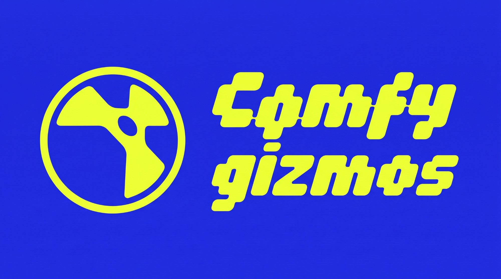

# ComfyGizmos

ComfyUI workflows as Nuke nodes. Connect a plate, press **Render in ComfyUI**,
and the node's output becomes the result. ComfyUI only has to be running in
the background, so you never leave Nuke.

The node talks to ComfyUI's HTTP API directly. The Nuke side is pure Python
(stdlib only).

## Gizmos

All of them are under **Nodes > ComfyUI**.

**Edit a frame**

| Node | Does | Frames | Output |
|---|---|---|---|
| **Qwen Image Edit** | Edits one frame from a text prompt, with up to 3 reference images (Qwen-Image 2.1) | single | ACES2065-1 |
| **Qwen Image Edit (Turbo)** | Same, with the fixed 8-step Turbo model | single | ACES2065-1 |
| **Qwen Outpaint** | Extends the frame out to a box you drag in the viewer, or to a 16:9 / 9:16 / 1:1 preset (Outpaint LoRA) | single | ACES2065-1, the bigger canvas |
| **Qwen Remove Background** | Removes the background and returns RGBA | single | ACES2065-1 + alpha |
| **Qwen Light Blend** | Relights an object pasted into the plate so it sits in the scene: light, highlights, contact shadow | single | ACES2065-1 |
| **Qwen Outfit Swap** | Dresses the person in the plate in the outfit from a second image | single | ACES2065-1 |
| **Flux 3 Klein Edit** | Edits one frame from a text prompt, with up to 3 reference images and 4 area boxes (FLUX 3 Image Klein, base model) | single | ACES2065-1 |
| **Flux 3 Klein Edit (Distilled)** | Same, with the faster step-distilled model | single | ACES2065-1 |
| **Nano Banana 2** | Edits one frame from a text prompt, with up to 5 reference images, or makes a new image when no plate is connected (Gemini 3.1 Flash Image on Google Vertex AI; paid per render) | single | ACES2065-1 |
| **Nano Banana Pro** | Same, with Gemini 3 Pro Image (costs more per render) | single | ACES2065-1 |

**New images**

| Node | Does | Frames | Output |
|---|---|---|---|
| **Qwen Text to Image** | A new image from a text prompt; no inputs (Qwen-Image 2.1) | one image | ACES2065-1 |
| **Qwen Text to Image (Turbo)** | Same, with the fixed 8-step Turbo model | one image | ACES2065-1 |

Nano Banana 2 and Pro also do text to image: see above.

**Video**

| Node | Does | Frames | Output |
|---|---|---|---|
| **MiniMax H3 Image to Video** | A new clip from a start frame, and optionally an end frame | from one frame | ACES2065-1, H3's own size |
| **MiniMax FastH3 Image to Video** | Same, with the 8-step FastH3 model: faster, a little less detail | from one frame | ACES2065-1, H3's own size |
| **MiniMax H3 Reference to Video** | A new clip from up to 3 reference videos (motion, camera) and 9 pictures (identity, style) named in the prompt | range, up to 360 | ACES2065-1, H3's own size |
| **MiniMax H3 VFX Edit** | The same take back with only the prompted change: add, remove or replace (VFX Edit LoRAs) | range, up to 362 | ACES2065-1 |
| **Veo 3.1 Image to Video** | A new clip from a start frame, and optionally an end frame (Google Vertex AI; paid per render) | from one frame | ACES2065-1, Veo's own size |
| **Veo 3.1 Reference to Video** | A new clip that keeps the look of up to 3 reference pictures (Vertex AI; paid per render) | from one frame | ACES2065-1, Veo's own size |
| **LTX 2.5 I2V HDR** | A new HDR clip from one HDR frame (LTX-2.5 Native HDR, two stages) | from one frame | ACES2065-1 |
| **LTX Refine** | Re-renders a frame range at a bigger output size, with new detail (LTX-2.5 Tiled Fusion + Refine Details IC-LoRA) | range, up to 241 | ACES2065-1, the size you pick |
| **LTX Layout to Render** | Turns a clay or playblast layout clip into a finished shot, following its camera and movement, with the look from an art-directed first frame and optional mid and last frames (LTX-2.5 Layout to Render IC-LoRA, two stages) | range, up to 241 | ACES2065-1, the layout's size |

**Mattes, HDR and data passes**

| Node | Does | Frames | Output |
|---|---|---|---|
| **LTX Alpha Gen** | Alpha matte from a plate, or from a cropped area of it (LTX-2.5 Alpha Gen IC-LoRA) | range, up to 145 | ACEScg-labelled matte |
| **LTX SDR to HDR** | SDR plate to scene-linear HDR (LTX-2.5 IC-LoRA) | range, up to 241 | ACES2065-1 |
| **LTX SDR to HDR (Tiled)** | Same, two stages with a latent x2 upscale | range, up to 241 | ACES2065-1, upscaled |
| **DSINE Normals** | Camera-space surface normals | single | raw EXR, decoded to -1..1 in the node |
| **VDA Depth** | Temporally consistent relative depth (Video Depth Anything Large) | range, up to 300 | raw 32-bit EXR |

**Text**

| Node | Does | Frames | Output |
|---|---|---|---|
| **Gemini 3.1 Pro** | Answers a prompt about a frame, a frame range (sent as video) or nothing; text only, the plate passes through (Vertex AI; paid per run) | frame / range / none | text reply |

## Licences

Each gizmo's **How to use** tab ends with the licence of its model as it
stood when checked (2026-11). In short: Qwen-Image 2.1 is research or
evaluation only; MiniMax H3 isn't authorised in the US, EU, UK or South
Korea; VDA Large is non-commercial; LTX-2.x is free under $10M annual
revenue; the Google nodes follow Google's API terms. Check the current terms
before paid work.

## Requirements

**Nuke** 14 or later (tested on NukeX 14.1, Python 3.9).

**ComfyUI** running locally (default `http://127.0.0.1:8188`) with
[ComfyUI-OCIO](https://github.com/SlavaSexton/ComfyUI-OCIO). Every gizmo
loads and writes through its OCIO Read and OCIO Write, using an ACES 1.2
config by default.

**ComfyUI v0.41.0 or newer.** Several models' nodes are part of ComfyUI
itself, so an older ComfyUI reports them as missing custom nodes, for example
`Node 'Qwen Image 2.1 Cache' not found`. The Flux 3 Klein gizmos need v0.41.0,
the Qwen gizmos v0.37.0 and the MiniMax H3 gizmos v0.34.0. To fix the error,
update ComfyUI and restart it; installing a custom node won't help.

**Graphics card.** The installer offers two model sizes:

- **Full**: the models the workflows were built with, for 32 GB cards
  (RTX 5090).
- **Medium**: smaller official quantisations of the big models from the same
  Hugging Face repos, for about 24 GB cards (RTX 4090, 3090): int8 instead of
  bf16 for LTX-2.5 and its Gemma encoders, w4a8 Qwen encoders and w6a8
  MiniMax H3 models. Expect a little less detail than Full.

The MiniMax H3 text encoder is NVFP4, which runs fast only on RTX 50 series
cards; on older cards the installer uses its int8 version instead (bigger, so
ComfyUI moves part of it to system RAM).

Download size per family, everything ticked:

| Family | Full | Medium |
|---|---|---|
| LTX-2.5 | 87 GB | 50 GB |
| Qwen-Image 2.1 | 44 GB | 36 GB |
| MiniMax H3 | 88 GB | 78 GB (90 GB on cards older than RTX 50) |
| Flux 3 Klein | 24 GB | 24 GB |
| Google (Vertex AI) | none | none |
| Depth and normals | downloaded by their packs | downloaded by their packs |

Per gizmo (the installer works this out for you; the files are the Full ones):

| Gizmo | Node packs | Models (ComfyUI `models/` folder) |
|---|---|---|
| LTX Alpha Gen | [ComfyUI-LTXVideo](https://github.com/Lightricks/ComfyUI-LTXVideo), `ltx_plate_tools` (this repo) | `diffusion_models/ltx-2.5-22b-distilled-transformer-bf16.safetensors`, `loras/ltx-2.5-22b-ic-lora-alpha-gen-0.9.safetensors`, `vae/ltx-2.5-video-vae-bf16.safetensors`, `vae/ltx-2.5-audio-vae-bf16.safetensors`, `text_encoders/gemma4-12b-with-proj-ltx-2.5-bf16.safetensors`, `text_encoders/gemma4_e2b_it_bf16.safetensors` |
| LTX SDR to HDR | ComfyUI-LTXVideo, `ltx_plate_tools` | the LTX-2.5 transformer and VAEs above, `loras/ltx-2.5-22b-ic-lora-sdr-to-hdr-1.0.safetensors`, `embeddings/ltx-2.5-22b-ic-lora-sdr-to-hdr-scene-emb.safetensors` |
| LTX SDR to HDR (Tiled) | ComfyUI-LTXVideo, `ltx_plate_tools` | as above, plus `latent_upscale_models/ltx-2.5-latent-spatial-upscaler-x2-bf16-1.0.safetensors` |
| LTX 2.5 I2V HDR | ComfyUI-LTXVideo | the LTX-2.5 transformer, VAEs and text encoders above, plus the x2 latent upscaler |
| LTX Refine | ComfyUI-LTXVideo, `ltx_plate_tools`, `audio_fallback` (this repo) | the LTX-2.5 transformer, VAEs and text encoders above, `loras/ltx-2.5-22b-ic-lora-refine-details-1.0.safetensors` |
| LTX Layout to Render | ComfyUI-LTXVideo, `ltx_plate_tools` | the LTX-2.5 transformer, VAEs, Gemma encoder and x2 latent upscaler above, `loras/ltx-2.5-22b-ic-lora-layout-to-render-1.0.safetensors` |
| Qwen Image Edit | `ltx_plate_tools` | `diffusion_models/qwen_image_2.1_int8_convrot.safetensors`, `vae/qwen_image_2.1_vae_bf16.safetensors`, `text_encoders/qwen3vl_8b_int8_convrot.safetensors`, `text_encoders/qwen3.5_9b_qwen_image_2.1_pe_i2i.int8_convrot.safetensors` (prompt enhancer) |
| Qwen Image Edit (Turbo) | `ltx_plate_tools` | as above, with `diffusion_models/qwen_image_2.1_turbo_int8_convrot.safetensors` |
| Qwen Text to Image (+ Turbo) | none beyond ComfyUI-OCIO | the Qwen-Image 2.1 (or Turbo) model, VAE and `qwen3vl_8b` encoder above, with the text-to-image enhancer `text_encoders/qwen3.5_9b_qwen_image_2.1_pe_t2i.int8_convrot.safetensors` |
| Qwen Outpaint | `ltx_plate_tools` | the Qwen-Image 2.1 model, VAE and `qwen3vl_8b` encoder, `loras/qwen-image-2.1-outpaint-v2.safetensors` |
| Qwen Remove Background | `ltx_plate_tools` | as Outpaint, with `loras/qwen-image-2.1-consistency.safetensors` |
| Qwen Light Blend | `ltx_plate_tools` | as Outpaint, with `loras/Qwenimag21_c2-st2000.safetensors` from [RunningHubAI](https://huggingface.co/RunningHubAI/rh-qwen-image-2.1-lora-2104918997757157378) |
| Qwen Outfit Swap | `ltx_plate_tools` | as Outpaint, with `loras/qwen-image-2.1-outfit-swap.safetensors` |
| MiniMax H3 Image to Video | [MiniMax-H3-Prompt-Rewriter-ComfyUI](https://github.com/pytraveler/MiniMax-H3-Prompt-Rewriter-ComfyUI) (prompt enhancer; the H3 nodes are part of ComfyUI) | `unet/minimax_h3_fl2va_pruned_int8_convrot.safetensors`, `loras/minimax_h3_fl2v_turbo_8step_v1.0_comfyui_bf16.safetensors`, `vae/minimax_h3_video_vae_int8_convrot.safetensors`, `clip/qwen3vl_32b_minimax_h3_nvfp4_awq.safetensors` |
| MiniMax FastH3 Image to Video | MiniMax-H3-Prompt-Rewriter-ComfyUI | `diffusion_models/fastvideo_fasth3_8step_v2_pruned_int8_convrot.safetensors`, plus the H3 VAE and encoder above |
| MiniMax H3 Reference to Video | MiniMax-H3-Prompt-Rewriter-ComfyUI | `unet/minimax_h3_ref2va_pruned_int8_convrot.safetensors`, `loras/minimax_h3_ref2v_turbo_4step_v0.1_comfyui_bf16.safetensors`, plus the H3 VAE and encoder above |
| MiniMax H3 VFX Edit | none beyond ComfyUI-OCIO | the Reference to Video model and turbo LoRA above, `vae/minimax_h3_audio_vae_fp32.safetensors`, and `loras/minimax_h3_vfx_edit_v1.0_r128_ffp.safetensors` from [Alissonerdx/Minimax-H3-ComfyUI](https://huggingface.co/Alissonerdx/Minimax-H3-ComfyUI) |
| DSINE Normals | [comfyui_controlnet_aux](https://github.com/Fannovel16/comfyui_controlnet_aux) | DSINE (downloaded by the pack on first use) |
| VDA Depth | [ComfyUI-Video-Depth-Anything](https://github.com/yuvraj108c/ComfyUI-Video-Depth-Anything) | `videodepthanything/video_depth_anything_vitl.pth` (downloaded by the pack on first use) |
| Flux 3 Klein Edit | `ltx_plate_tools` (the Flux nodes are part of ComfyUI) | `diffusion_models/flux3_image_klein_base_int8_convrot.safetensors`, `vae/flux2-vae.safetensors`, `text_encoders/qwen3vl_4b_int8_convrot.safetensors`, `text_encoders/qwen3.5_9b_flux3_prompt_upsampler_w4a8.safetensors` (prompt upsampler), from [black-forest-labs/flux-3-image-klein-comfy](https://huggingface.co/black-forest-labs/flux-3-image-klein-comfy) |
| Flux 3 Klein Edit (Distilled) | `ltx_plate_tools` | as above, with `diffusion_models/flux3_image_klein_sd_int8_convrot.safetensors` |
| Nano Banana 2, Nano Banana Pro, Veo 3.1 (both), Gemini 3.1 Pro | [comfyui-google-genmedia-custom-nodes](https://github.com/GoogleCloudPlatform/comfyui-google-genmedia-custom-nodes), `ltx_plate_tools` | none local: they call Vertex AI. You need a Google Cloud project with Vertex AI enabled, signed in with `gcloud auth application-default login` |

The Lightricks (LTX-2.5) and Flux 3 Klein repos on Hugging Face are gated:
accept their licence on the model page while signed in, and give the installer
a [Hugging Face token](https://huggingface.co/settings/tokens). ComfyUI only
lists `embeddings/` at startup, so restart it after adding the scene
embedding.

## Install

1. Download this repo (**Code > Download ZIP**, or `git clone`) and unzip it.
2. Double-click **`install.bat`** (Windows) or **`install.command`** (macOS,
   Linux). It opens the installer with the Python inside Nuke, so you don't
   need your own Python. It uses the newest Nuke it finds; to pick one, run
   `install.bat "C:\Program Files\Nuke15.1v5\python.exe"`.
3. In the installer:
   - Check the **ComfyUI folder** (the one with `custom_nodes` and `models`)
     and **ComfyUI's Python**. Both are found for you when ComfyUI is running
     or in a usual place. It warns if ComfyUI is too old.
   - Pick the **model size**. It suggests one from your graphics card.
   - Untick the gizmos you don't want. Each line shows what it is missing and
     its download size, with the total at the bottom (files shared by several
     gizmos counted once).
   - For gated models, paste a Hugging Face token. It isn't saved.
   - Press **Install**.
4. Restart ComfyUI and Nuke, then run **Nodes > ComfyUI > Check setup...**.

The installer:

- copies this repo's two ComfyUI node packs into `custom_nodes`:
  `ltx_plate_tools` (Plate Prep and Restore, Plate Aspect Pad and Veo Video
  Frames) and `audio_fallback` (the silent audio track LTX Refine needs);
- clones the other node packs the ticked gizmos need and installs their
  Python requirements with ComfyUI's own Python (uses `git` if you have it,
  else downloads the zip);
- downloads the missing models from Hugging Face into ComfyUI's `models`
  folders, under the file names the workflows use. Files you already have, in
  any sub-folder, are skipped, and a cancelled download carries on where it
  stopped next time;
- copies the gizmos to `~/.nuke/python` (or the folder you pick) and adds
  the lines that load them to `~/.nuke/menu.py`, after backing it up. Run it
  again to update: it replaces its own lines;
- saves the model size and the ticked gizmos in
  `~/.nuke/comfygizmos_prefs.json`. Only the ticked gizmos appear in the menu.

To update, download the repo again and run the installer again. Gizmos added
since your last install are marked new and ticked; only what is missing is
downloaded, and the gizmos and their `menu.py` lines are replaced, not
doubled. Node packs you already have aren't updated: update those with
ComfyUI-Manager or `git pull`. Run it again any time to add gizmos or change
the model size. Unticking a gizmo hides it from the menu but never deletes
models.

**Check setup** asks the running ComfyUI what it has, and lists for each
gizmo the node packs and model files still missing, with download links. It
also flags a ComfyUI that is too old, an OCIO config without ACES, and NVFP4
models on a card older than RTX 50.

**By hand**, without the installer:

1. Copy `comfyui_nodes/ltx_plate_tools` and `comfyui_nodes/audio_fallback`
   into `ComfyUI/custom_nodes/`, install the node packs and models in the
   Requirements table, and restart ComfyUI.
2. Run `python install.py`. It copies `comfygizmos` to `~/.nuke/python/`, or
   pass another folder on your Nuke plugin path.
3. Add to `menu.py`, then restart Nuke:

   ```python
   try:
       import comfygizmos
       comfygizmos.register_menu()   # Nodes > ComfyUI > one entry per workflow
   except Exception as _err:
       nuke.tprint('comfygizmos failed to load: %s' % _err)
   ```

After an update, existing nodes in a script keep working only if the
workflow's knobs haven't changed; if a render reports a missing knob, make a
new node. Nodes made as **LTX Upscale** open as LTX Refine.

## Use

Create the node from **Nodes > ComfyUI** (or Tab), fill in **Name** if
needed, and press **Render in ComfyUI**. With a node selected, the gizmo is
connected to it and inserted into the pipe below it, like any Nuke node. The
render runs in the background and **status** reports progress, so Nuke stays
usable. Each node has a **How to use** tab with notes for that gizmo; you can
edit them.

### Inputs

The **input** (or source) is whatever is connected to the gizmo. Reference
inputs (`ref`, `last`, `outfit`, `picture`, ...) count as inputs too.

- **A plain Read**, connected straight in with no frame offset, is sent to
  ComfyUI as it is. Nothing is rendered.
- **Anything else** (a Grade, Merge, Crop, ...) is rendered to EXR first,
  into the `sources` folder, and that render is sent.
- **Nothing**: the Qwen Text to Image gizmos have no input, and Nano Banana 2
  and Pro make a new image when their plate is left unconnected.

### Name

**Name**, at the top, names everything the node writes. It's required unless
the input is a plain Read; with a plain Read and Name left empty, the plate's
file name is used. With no input, an empty Name becomes `Prompt`. Gemini 3.1
Pro starts with Name `Chat`, so it can run without anything typed.

The gizmo part of the name is fixed per gizmo: `LTXAlpha`, `LTXHDR`,
`LTXHDRTiled`, `LTXI2VHDR`, `LTXRefine`, `QwenEdit`, `QwenEditTurbo`,
`QwenT2I`, `QwenT2ITurbo`, `QwenOutpaint`, `QwenBGRemove`, `QwenLightBlend`,
`QwenOutfit`, `Flux3Klein`, `Flux3KleinDistilled`, `NanoBanana2`,
`NanoBananaPro`, `MiniMaxH3`, `FastH3`, `H3Ref`, `H3VFXEdit`, `Veo31`,
`Veo31Ref`, `DSINENormal`, `VDADepth` or `Gemini31Pro`.

### Folders and versions

Everything goes under **output root**, which defaults to
`[value root.project_directory]/Comp/Inputs/ComfyUI`. It follows the script's
project directory, or one folder up from the .nk when that is empty.

```
<output root>/
├── sources/<Name>_<Gizmo>/<Name>_<Gizmo>_Source_v001.####.exr     (rendered inputs)
│                          <Name>_<Gizmo>_Source_ref2_v001.####.exr (references)
└── outputs/<Name>_<Gizmo>/<Name>_<Gizmo>_v001_<colorspace>.####.exr
```

The **source** and **output** versions are separate:

- **source** + **Version up source**: Render in ComfyUI uses
  `_Source_v###` if it is already on disk, and renders it first if not. If
  only some frames are missing, only those are rendered. Changed something
  upstream? Press **Version up source** and the input is rendered fresh at the
  next render. Typing an older number goes back to that render. Both controls
  are greyed out when every connected input is a plain Read.
- **version** + **Version up output**: the output version, starting at 001.
  To try again from the same source (a new seed, other settings), press
  **Version up output**. The source is reused and earlier outputs are kept.
  Rendering over an existing output version asks before overwriting.
- The node's **label** shows the Name, the output version and the render
  state, e.g. `WallFix` / `v003` / `done`. The node colour follows the state:

  | State | Colour |
  |---|---|
  | `rendering`, `queued` (and `refining` for Run enhancer only) | yellow |
  | `done` | green |
  | `failed`, `cancelled` | red |
  | not rendered yet, `refined` | the normal blue |

Output frames keep the plate's frame numbers. Gizmos that make a new clip
number it from the frame that was sent; the Qwen Text to Image gizmos write
frame 1 and hold it on every frame. The colorspace tag in the file name comes from OCIO Write.

### Highlights

Most of the models work on display-referred 0-1 images, so scene-linear
values above 1 can't go through them unchanged. Every gizmo that sends an
image to such a model has a **highlights** menu:

- **roll off**: the image goes in through the inverse of ACES `Output - sRGB`
  and comes back through it, so highlights are compressed rather than cut.
  They return approximately, saturated colours shift, deep shadows are
  crushed (below about 0.003 scene-linear they come back flat) and new
  near-whites come back hot (display 0.98 is about 7, 1.0 is about 16).
- **clip**: plain sRGB in and out. Values above 1 are cut, shadows stay open
  and whites stay at 1.

It defaults to **roll off** on the image and video gizmos, and to **clip** on
DSINE Normals, VDA Depth and LTX Alpha Gen, where it only sets what the
model sees. The LTX HDR gizmos have no menu, since they work in scene-linear.
On Gemini 3.1 Pro it only applies to what is sent.

Either way, comp the result back over the plate only where it changed.

### Other controls

- **input range** / **first** / **last** (range gizmos): input range on uses
  the input's range; off uses first and last. **max frames** caps the range
  and is also passed to ComfyUI.
- **frame** + **Set to current frame** (single-frame gizmos): the frame to
  process. It doesn't follow the playhead. **hold on all frames** shows the
  result on every frame. The text to image gizmos have no frame.
- **crop** + **crop area** (LTX Alpha Gen, Qwen Image Edit, Remove
  Background, Light Blend, Outfit Swap, Nano Banana): send only an area of the plate, for more detail on a small fix.
  The area starts as the whole plate and follows the plate's resolution until
  you move it in the viewer. The result is put back in the full plate frame.
- **seed** + **increment** (gizmos with a seed): with increment on (the
  default), the seed goes up by 1 after each render is sent, as ComfyUI's
  "increment" does, so every render is a new attempt. The seed a render used
  is in its status line. Untick increment to keep a seed and reproduce a result.
- **advanced** is a closed section on every gizmo. It holds **colorspace
  override** and the workflow's less-used settings (negative prompt, top p /
  top k, system instruction, GCP project and region). On gizmos with a prompt
  enhancer it sits right under **refine prompt** (or **enhance prompt**) and
  also holds **Run enhancer only**, **Use refined prompt** and **refined
  prompt**.
- **colorspace override**: leave it empty and the colorspace comes from the
  Read; a Read on `default` (or an OCIO role) counts as ACES2065-1. ACES 1.2,
  1.3 and 2.0 names, and nuke-default names, are matched to ComfyUI's config.
- **output colorspace**: the written files' colorspace, which the node's Read
  also uses.
- **Reload result**, **Cancel** and **Bring in output**.
  - **Bring in output** puts a Read of the result straight under the node,
    with any extra nodes stacked below it.
  - Single-frame results come in as a still of the actual file, so they show
    on every frame.
  - LTX Alpha Gen adds a Crop and a red-to-alpha Shuffle (see below), DSINE
    Normals adds its -1..1 decode, and Qwen Outpaint adds a Transform that
    lines the bigger canvas up with the plate.
  - The node's own Read skips Nuke's file localization, so re-rendering a
    version always shows the new files.

### Gizmo notes

- **LTX Alpha Gen**:
  - Seed, work scale and LoRA strength. **output** is `matte` (rgba = matte)
    or `input + matte alpha`. The matte is written untouched and labelled
    ACEScg.
  - With **crop** on, only the crop area is sent. **reformat** shows the
    cropped plate exactly as it's sent; the box handles are hidden while it's
    on. The input is always rendered to `sources/`, even from a plain Read.
    The matte is written at crop size and shown back in the full plate frame.
  - Each source version keeps the area it was rendered with (a `.crop.json`
    next to it). After moving the area, press **Version up source**.
  - **Bring in output** builds Read → Crop → Undo crop → Shuffle (red → rgba).
    The Undo crop puts a crop-size matte back at plate resolution and
    position, like a manual "undo crop".
- **LTX SDR to HDR (Tiled)**: seed and LoRA strength drive both stages. The
  output is at the upscaled size.
- **LTX 2.5 I2V HDR**: the input must already be real HDR; it isn't upgraded
  from SDR (use LTX SDR to HDR for that). **long edge** is the final size,
  with the input's aspect. **image strength** 1.0 locks the first frame to
  the still. The prompt is optional and describes the motion.
- **LTX Refine**: **output size** and **tile size** (how much the model sees
  at once; lower it, the output size or the frame count if it runs out of
  memory). The prompt is optional and should describe only look and style:
  named objects or people can stamp into every tile. Detail is generated, so
  faces, text and fine patterns can drift; check it against the plate.
- **LTX Layout to Render**: connect the layout clip to **layout** (it sets
  the camera and the movement) and the art-directed first frame to **first**
  (required): the layout's first frame made into the finished look with any
  image model, not the grey clay frame itself. Optional **mid** and **last**
  stills hold the look through the shot: **last** goes on the last frame
  sent, **mid** at **mid frame** (0 = the middle). Each still sends the
  layout frame at its place, or the still itself. The **prompt** describes
  the finished shot in a sentence or two; don't write "clay", "3D" or
  "Unreal". It renders at 544 px on the short side, then x2; **output size**
  scales it back to the layout's size. The mid and last frames use LTX's
  keyframe guide in both stages; Lightricks doesn't publish a ComfyUI recipe
  for them.
- **Qwen Image Edit / Turbo**:
  - **prompt** is the edit instruction. The plate is `<image1>`; the refs are
    `<image2>`-`<image4>`.
  - **refine prompt** lets the Qwen prompt enhancer rewrite the instruction
    first. **Run enhancer only** runs just the enhancer and shows its rewrite
    in **refined prompt**. **Use refined prompt** copies the rewrite into
    **prompt** and turns refining off.
- **Qwen Text to Image / Turbo**: no inputs. **width** and **height** set the
  size (native up to 2048x2048, multiples of 32). Same enhancer as Qwen Image
  Edit. The official pipeline uses about 40-50 steps; 25 is a faster start.
- **Qwen Outpaint**:
  - With the panel open, drag the **extend area** box outside the plate in
    the viewer. It starts as the whole plate, which adds nothing, and a side
    pulled inside the plate adds nothing either.
  - **aspect** (custom, 16:9, 9:16, 1:1) snaps the box to the smallest box of
    that shape that holds the plate, centred on it. Move the box to put more
    of the new area on one side; dragging a handle changes the shape and sets
    aspect back to custom. Anamorphic plates use the shape as seen, with the
    pixel aspect counted.
  - Keep the prompt's first sentence (the LoRA's trigger), and after `Scene:`
    describe the whole picture. The whole canvas renders within the
    **resolution** budget (1024 = about 1 MP), so big extensions lose detail
    in the plate area: comp only the new areas back in.
- **Qwen Remove Background**: say what to remove and keep in the prompt; the
  wording decides whether Qwen returns real alpha. The alpha is premultiplied
  on read.
- **Qwen Light Blend**: feed the rough comp (object already over the
  background) into `comp`, and keep `pengyu` first in the prompt (the LoRA's
  trigger). Comp the result back only around the object and its shadow.
- **Qwen Outfit Swap**: the plate is the person (image 1) and `outfit` the
  outfit picture (image 2). Add `Keep their own shoes and legwear.` to the
  prompt to keep those.
- **Flux 3 Klein Edit / Distilled**:
  - **prompt** describes the whole result with the edit folded in. The plate
    is `<ref_image_0>`, the refs are `<ref_image_1>`-`<ref_image_3>`, and box N
    is `<obj_N>`. For example: `In <ref_image_0>, replace the jacket <obj_1>
    with a navy wool overcoat; keep everything else the same.`
  - **boxes** (closed section): up to 4, each switched on, given a short
    **description** of what is in the box now (e.g. `jacket`), and dragged in
    the viewer as **area**. They start in the four corners and are sent in
    plate pixels.
  - **refine prompt** runs Flux's prompt upsampler (off by default), with the
    same enhancer buttons as Qwen. **megapixels** sets the working size (the
    result is scaled back to plate size). Steps default to 50 on base and 16 on
    distilled; base also has a **negative prompt** in advanced.
- **Nano Banana 2**:
  - **prompt** is the edit instruction. The plate is image 1; the `ref2`-`ref6`
    inputs are images 2-6.
  - **image size** (512px-4K) is the size Nano Banana renders at; the result
    is scaled back to plate size, and bigger sizes cost more. **temperature**
    controls randomness. There's no seed, so every render differs.
  - **Text to image**: connect nothing to `plate`. Pick **aspect ratio** and
    **image size**; the result stays at the model's own size. Refs still work
    and count from image 1, and crop is ignored. **aspect ratio** is greyed
    out while a plate is connected, since the plate sets the aspect.
  - **advanced** holds top p, top k, a system instruction and the **GCP
    project**. That project is billed; leave it empty to use the
    `GOOGLE_CLOUD_PROJECT` environment variable, or set your own default (see
    Local defaults).
  - The plate is padded to the nearest aspect ratio Nano Banana supports, and
    the padding is cropped off afterwards. The whole frame is regenerated.
- **Nano Banana Pro**: as Nano Banana 2, with Gemini 3 Pro Image; **image
  size** is 1K, 2K or 4K.
- **MiniMax H3 / FastH3 Image to Video**:
  - Connect the start frame to `first` and, optionally, an end frame to
    `last`. Prompt the motion and camera; the start frame is `<Picture 1>`.
    Pick the length in **frames**.
  - **turbo** (H3 only) runs 8 steps, much faster. FastH3 is always 8 steps.
  - **enhance prompt** has a local LLM expand a short prompt into H3's
    structured description. **remove audio from prompt description**
    (advanced, on by default) clears its sound sections; dialogue written in
    the visual description stays.
- **MiniMax H3 Reference to Video**: name references in the prompt as
  `<Video 1>`.. (motion, camera, action) and `<Picture 1>`.. (identity,
  style). Tick video 2-3 and picture 1-9 to add inputs; connected inputs are
  numbered without gaps and the status line lists the tags. It doesn't keep
  the plate. Same enhancer and remove audio option as Image to Video.
- **MiniMax H3 VFX Edit**: start the prompt with `vfx_edit:`, then one
  sentence: the edit, then what must stay the same. An optional
  `first_frame` (a frame you already fixed, named `<Picture 1>` in the
  prompt) carries that edit through the shot; use an FFP LoRA with it.
- **Veo 3.1 Image to Video / Reference to Video**: **model**, **duration**,
  **resolution** and **seed**; person generation and the GCP project and
  region are in advanced. Output is at Veo's own size (16:9 or 9:16), no
  audio. Reference to Video takes up to 3 pictures on `ref1`-`ref3` (ref1 can
  be the plate) and doesn't start on the frame. Weapon or violence wording
  gets blocked by Google's filter.
- **DSINE Normals**: fov, iterations and resolution. **output** is
  `normals -1..1` or `encoded 0..1`.
- **VDA Depth**: relative inverse depth (white = near, black = far), not
  metric. 0-1 is normalised over the frames sent, so render the whole shot in
  one go. **input size** is the short side the model sees: higher means more
  detail and much more VRAM. Desqueeze anamorphic plates first.
- **Gemini 3.1 Pro** (text, not images):
  - **send**: `frame` (one frame, as PNG), `frame range as video` (the range as
    an H.264 MP4, up to 600 frames) or `text only` (just the prompt).
  - **model** (3.1 Pro, 3 Flash, 3.1 Flash Lite), **temperature** and **max
    output tokens**; top p, top k, system instruction and GCP project are in
    advanced.
  - The answer appears in **reply** and is saved as
    `outputs/<Name>_Gemini31Pro/<Name>_Gemini31Pro_v###.txt`. **Copy reply**
    puts it on the clipboard; **Send to prompt below** writes it into the
    prompt of every ComfyGizmo connected below this node.

### Local defaults

Machine- or account-specific defaults live in `~/.nuke/comfygizmos_prefs.json`
rather than in the repo:

```json
{
  "host": "http://127.0.0.1:8188",
  "output_subpath": "Comp/Inputs/ComfyUI",
  "knob_defaults": {
    "nano_banana2": {"gcp_project": "your-gcp-project"},
    "nano_banana_pro": {"gcp_project": "your-gcp-project"},
    "veo31_i2v": {"gcp_project": "your-gcp-project"},
    "veo31_r2v": {"gcp_project": "your-gcp-project"},
    "gemini31_pro": {"gcp_project": "your-gcp-project"}
  }
}
```

`knob_defaults` sets the starting value of any knob, per workflow id, on newly
created nodes.

The installer adds three more keys; without them every gizmo is shown and the
Full models are used:

- `"tier"`: `"full"` or `"medium"`, the model size. The gizmos point their
  model loaders at that size's files when they render.
- `"fp4"`: `false` swaps NVFP4 models for their int8 versions (cards older
  than RTX 50).
- `"gizmos"`: the workflow ids shown in **Nodes > ComfyUI**.
- `"known"`: every workflow there was when the installer ran. Gizmos added
  in a later update are shown, and ticked and marked new in the installer,
  until you untick them.

## Adding a workflow

1. Build it in ComfyUI with an **OCIO Read** in and an **OCIO Write** out.
   Subgraphs are fine; the API export flattens them. If the model's VAE
   returns RGBA, split off the alpha (or go through Plate Restore) before the
   OCIO Write, which misorders a 4-channel image.
2. Export it in API format: *Save (API)*, or `app.graphToPrompt()` in the
   browser console. Clear the OCIO Write's folder and filename first.
3. Run
   `python tools/make_api.py export.json comfygizmos/workflows/<id>.api.json <write_node_id> [ids of preview-only nodes to drop]`
4. Write `comfygizmos/workflows/<id>.json`, using an existing manifest as the
   template. It holds:
   - the read and write node ids
   - `suffix`, which becomes the gizmo name
   - `frames: single` or a range with `max_frames`
   - the output kind (`matte` / `image` / `normals`) and colorspace
   - `usage`: the lines of the **How to use** tab
   - optional `refs` and `enhancer`
   - the knobs to expose: each one is a `node` + `input` in the API graph, or
     a list of `targets` when one knob drives several nodes. Types are `int`,
     `float`, `bool`, `string`, `multiline`, `choice` (with `values`, and
     optional `labels` for what the menu shows) and `bbox` (a box in the
     viewer). Two types only lay out the panel: `divider` (a heading) and
     `group` (a closed section up to the next group). `env_fallback` names an
     environment variable that is used when the knob is left empty. On a
     `bool`, `invert` flips the value sent, for switches that mean the
     opposite. `near_refined` places an advanced knob right under the
     **refined prompt** box.
   - optional `boxes` ({`node`, `count`, `after`}): area boxes for a Create
     Bounding Boxes node, as on the Flux gizmos.
   - optional `crop` ({`default`}): the source crop, as on LTX Alpha Gen.
   - optional `extend_area` ({`node`}): pads the plate out to a `bbox` knob
     named `extend_area`, as on Qwen Outpaint.
   - optional `no_input` (the gizmo has no input), or `no_plate`
     ({`remove`, `unlink`, `set`, `write_images`}): the graph changes that
     turn it into text to image when no plate is connected, as on Nano Banana.
   - optional `default_name`: the Name a new node starts with.
   - in `refs`, a ref can be `required` (`true`, or a sentence saying what
     to connect), sit at a `position` in the clip (`{"at": "last"}` or
     `{"knob": name}`, with `targets` for the frame index), and `bypass` its
     guide nodes when nothing is connected (`[{node, outputs}]`), as on LTX
     Layout to Render.
5. If the graph loads a model file that isn't in the catalog yet, add it to
   `SOURCES` in `tools/make_catalog.py` (and its smaller version to `MEDIUM`,
   if there is one), then run `python tools/make_catalog.py`. It reads sizes
   from Hugging Face and stops if any workflow loads a file it doesn't know.
   A new custom node goes in `PACKS`, and the gizmo in a `FAMILIES` group.
6. Run `python install.py` (or the installer) and restart Nuke.

## Tests

These need ComfyUI running and do real renders. Run each with
`Nuke14.1.exe --nukex -i -t tests/<test>.py <repo_dir> <project_dir> ...`
(see each file's docstring). Prefix frame numbers with `f`, as in `f1001`,
because Nuke reads bare numbers as a frame range.

- `nuke_test_naming.py`: Name, sources/outputs, and the source and output
  versions.
- `nuke_test.py`, `nuke_test_workflow.py`, `nuke_test_qwen.py`,
  `nuke_test_normals.py`: end-to-end per gizmo. The gizmos added since
  (text to image, Outpaint, the video gizmos, VDA Depth, LTX Refine, LTX
  Layout to Render and I2V HDR) have no tests yet, and the Google gizmos have none because every run
  is a paid API call.
- `test_colorspace.py`: colorspace name matching against the live ComfyUI.
